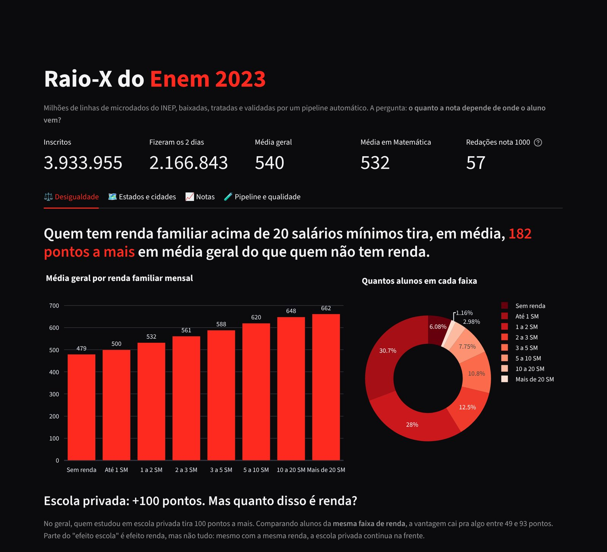
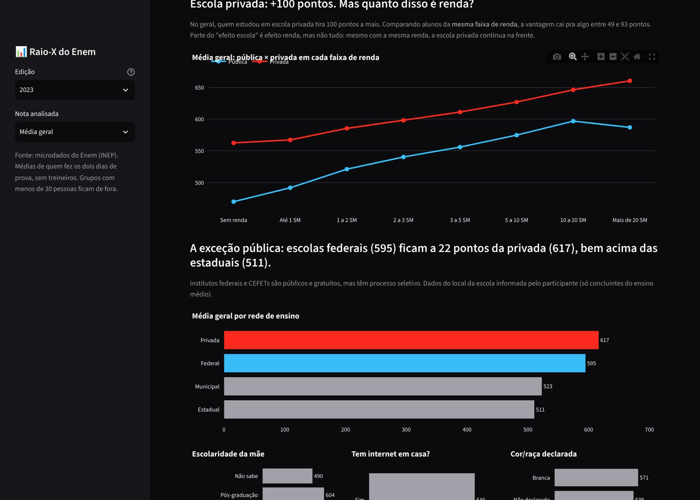

<div align="center">

# 📊 Raio-X do Enem

**Pipeline de dados que baixa, trata e valida os microdados do Enem (INEP) e mostra o quanto a nota depende de onde o aluno vem.**

[](https://github.com/SaMoCaSa00/Raio-X-ENEM/actions/workflows/tests.yml)


[](https://raio-x-enem.streamlit.app)



</div>

## O que os dados mostram (Enem 2023)

Médias de **2,17 milhões** de participantes que fizeram os dois dias de prova, sem treineiros.

| | Média geral |
|---|:-:|
| Família sem renda | **479** |
| Família com mais de 20 salários mínimos | **662** (+182) |
| Escola pública | 516 |
| Escola privada | 616 (+100) |
| Escola **federal** (IFs, CEFETs) | **595**, só 22 pontos atrás da privada |
| Escola estadual | 511 |
| Mãe que nunca estudou × mãe com pós-graduação | 470 × 604 |
| Sem internet em casa × com internet | 484 × 546 |

**A diferença entre pública e privada é em parte efeito da renda, mas não toda.** Comparando alunos da mesma faixa de renda, a vantagem da escola privada cai de 100 pontos pra algo entre 49 e 93 pontos, dependendo da faixa.

<p align="center"></p>

## O pipeline

```
INEP (zip de ~550 MB por edição)
   │  1. aquisição    download com retomada · sha256 · teste de integridade do zip
   ▼
CSV latin-1, separador ';', tudo texto (1,8 GB em 2023; 2,1 GB em 2024)
   │  2. tratamento   DuckDB em streaming · tipagem · decimal com vírgula · códigos → rótulos
   ▼
Parquet tipado (97 MB, 18× menor que o CSV)
   │  3. qualidade    regras de validação; problema sistemático = pipeline para
   ▼
   │  4. agregação    tabelas de KB; grupos com < 30 pessoas são removidos
   ▼
data/  →  app Streamlit
```

```bash
pip install -r requirements-pipeline.txt
python rodar.py 2023 2024        # roda as 4 etapas pra cada edição
streamlit run app.py             # (pip install -r requirements.txt)
```

### Problemas reais que o pipeline resolve

- **O INEP bloqueia acesso de fora do Brasil.** O download falha nos servidores do GitHub Actions (EUA), então a aquisição roda numa máquina no Brasil e só os agregados vão pro repositório.
- **Cadeia de certificados incompleta.** O servidor do INEP não manda o certificado intermediário. O navegador completa sozinho e o Python não. O pipeline lê o endereço do emissor no próprio certificado (extensão AIA), baixa o intermediário e **mantém a verificação TLS ligada**.
- **O formato mudou em 2024.** O INEP passou a publicar notas e questionário socioeconômico em arquivos separados, **sem chave em comum** (pra proteger a privacidade). O tratamento detecta isso e só gera as análises possíveis pra cada ano. Por isso as análises de renda só existem até 2023.
- **Dados "sujos":** encoding latin-1, decimais com vírgula, campos vazios, códigos em vez de nomes (`Q006 = 'D'` vira "1,5 a 2 salários mínimos").
- **Arquivos maiores que a memória:** o DuckDB lê o CSV em streaming e grava em Parquet com zstd, sem carregar nada inteiro.

### Qualidade dos dados

Cada edição passa por regras como: nota entre 0 e 1000, redação igual à soma das 5 competências, ausente sem nota, inscrição sem duplicata e códigos dentro do dicionário. O relatório fica em `data/<ano>/qualidade.json` e aparece no app.

Em 2023 o pipeline achou **1 redação (em 3,9 milhões) cuja nota não bate com a soma das competências**. Uma anomalia isolada é registrada, mas não descarta o ano. Um problema acima de 0,001% das linhas para o pipeline.

## Estrutura

```
pipeline/
  aquisicao.py    download com retomada + cadeia TLS + integridade
  tratamento.py   CSV → Parquet tipado, junção de arquivos, rótulos
  qualidade.py    regras de validação e relatório
  agregacao.py    tabelas pequenas pro app
  dicionario.py   tradução dos códigos do INEP
rodar.py          roda tudo
app.py            painel Streamlit
tests/            pytest com um CSV falso no formato do INEP (latin-1, vírgula decimal, ausentes)
```

## Limitações

- As médias por estado e cidade usam o **local de prova**, não onde o aluno mora.
- Correlação não é causa: renda, escolaridade dos pais, internet e escola andam juntas.
- Em 2024 não dá pra separar treineiros (a informação ficou no arquivo de participantes), então a comparação entre anos é aproximada.

## Fonte

[Microdados do Enem, INEP](https://www.gov.br/inep/pt-br/acesso-a-informacao/dados-abertos/microdados/enem). Dados públicos e anonimizados.

## Autor

**Samuell Moura**, Engenharia de Computação (UFU) · [LinkedIn](https://www.linkedin.com/in/samuell-carreiro/) · [GitHub](https://github.com/SaMoCaSa00)

Licença MIT.
